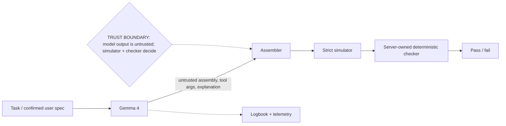

# ForgeASM-v1

ForgeASM is a local-first hardware architecture lab where Gemma learns a custom ISA in context, writes assembly, repairs it through assembler/simulator tools, and earns a pass only from a deterministic checker.


## Quick start

```bash
python -m venv .venv
.venv\Scripts\python.exe -m pip install -r requirements.txt
.venv\Scripts\python.exe -m pytest -q
cd frontend
npm ci
npm run build
```

Run the API with `..\.venv\Scripts\python.exe -m uvicorn api.main:app --reload` from the repository root, then open the frontend with `npm run dev`. Model use is optional for the simulator; configure `GEMMA_BACKEND`, `GEMMA_FAST_MODEL`, and the local endpoint for Copilot.

## Architecture and trust boundary



See [docs/ARCHITECTURE.md](docs/ARCHITECTURE.md) and [docs/AUDIT.md](docs/AUDIT.md).

## Measured results

Generated from `eval/results.json` by `python -m scripts.generate_judge_docs`.

### Per ISA

| name | n | assemble_ok@1 | pass@1 | pass@repair | mean_repair_turns | tokens | latency_ms | tokens/sec | efficiency_ratio | bytes_off_device |
|---|---|---|---|---|---|---|---|---|---|---|
| cisc | 24 | 1 | 1 | 1 | 0 | 24 | 0.093 | 277777.2789 | 1.0 | 8581 |
| risc1 | 28 | 1 | 1 | 1 | 0 | 24 | 0.0935 | 299227.2212 | 1.0 | 5982.4286 |
| risc2 | 24 | 1 | 1 | 1 | 0 | 24 | 0.0941 | 289318.5804 | 1.0 | 6403 |
| risc3 | 32 | 1 | 0.875 | 0.875 | 0.375 | 33 | 0.1141 | 304994.3231 | 1.0 | 9975.8125 |

### Per model

| name | n | assemble_ok@1 | pass@1 | pass@repair | mean_repair_turns | tokens | latency_ms | tokens/sec | efficiency_ratio | bytes_off_device |
|---|---|---|---|---|---|---|---|---|---|---|
| mock | 108 | 1 | 0.963 | 0.963 | 0.1111 | 26.6667 | 0.0996 | 293967.4181 | 1.0 | 7836.5741 |

### Ablations

| name | n | assemble_ok@1 | pass@1 | pass@repair | mean_repair_turns | tokens | latency_ms | tokens/sec | efficiency_ratio | bytes_off_device |
|---|---|---|---|---|---|---|---|---|---|---|
| card-no-examples | 27 | 1 | 0.963 | 0.963 | 0.1481 | 27.5556 | 0.1183 | 250133.5778 | 1.0 | 10255.8519 |
| full-card | 27 | 1 | 0.963 | 0.963 | 0.1481 | 27.5556 | 0.1187 | 251945.1791 | 1.0 | 10351.1481 |
| no-card | 27 | 1 | 0.963 | 0.963 | 0.1481 | 27.5556 | 0.072 | 396570.8376 | 1.0 | 1850.4444 |
| no-repair | 27 | 1 | 0.963 | 0.963 | 0 | 24 | 0.0895 | 277220.078 | 1.0 | 8888.8519 |

The complete generated report is [eval/RESULTS.md](eval/RESULTS.md). The current artifact explicitly records when real model backends are unavailable; no unavailable backend is scored as zero.

## Privacy

Local mode sends model requests only to the configured localhost-compatible model endpoint and reports zero off-device bytes. Cloud mode is opt-in and visibly reports off-device telemetry. The simulator/checker remains local and server-owned.


## License

Apache-2.0. See [LICENSE](LICENSE).
