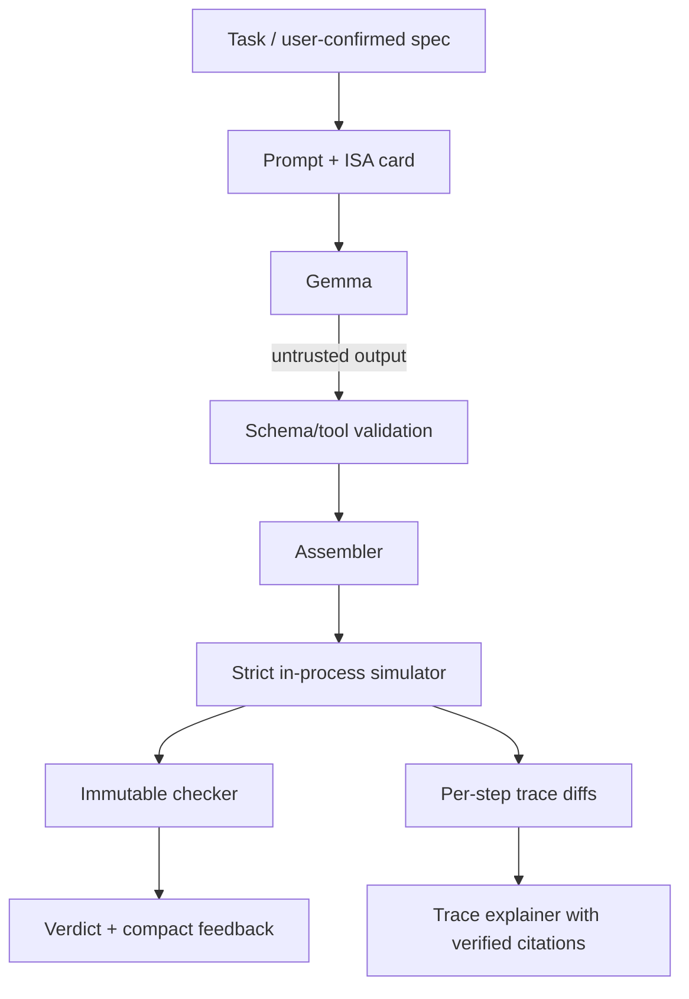

# Architecture

1. A task or user-confirmed specification provides natural-language intent, initialization, and expected values.
2. Gemma receives the ISA card and emits only assembly, tool-call arguments, or explanations.
3. The agent validates tool arguments before calling `assemble`, `run`, `inspect`, or `submit`.
4. The assembler produces machine code or structured diagnostics.
5. The strict simulator executes in-process with a cycle cap and optional state-diff trace.
6. A server-owned checker compares declared registers, flags, memory, halt state, or translation observables.
7. Only the checker produces the pass/fail verdict.

The trust boundary is between model output and execution: model output is untrusted; only the simulator and checker decide behavior and correctness.
